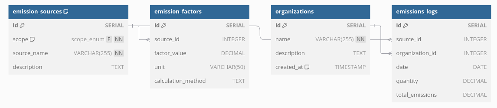

# CO2 Carbon Emissions Project

[](https://github.com/ValantisChatzimagkas/CO2-emissions-project/actions/workflows/ci.yml)

This project generates synthetic data about CO2 emissions from organizations,
categorized into Scope 1, Scope 2 and Scope 3 emissions, and loads it into a PostgreSQL database
modelled for GHG emissions tracking.

**Stack:** Python · pandas · SQLAlchemy · Faker · PostgreSQL · Docker Compose


## How to run
You can run this project using the `docker compose` that is provided
```bash
docker compose up
```

## Database Schema:



## Database Entities Explanation:
### Emission Sources:
The Emission Sources Table in this app represents various sources of greenhouse gas (GHG) emissions associated with an 
entity’s operations. <br> It categorizes different activities or processes that produce emissions, 
typically organized by Scope 1, Scope 2, and Scope 3. <br>
Each entry in the table specifies the type of emission source (e.g., energy use, transportation, industrial processes), 
the associated emissions factor (how much CO₂e is emitted per unit of activity), and the quantity of emissions from 
that source. This table helps track, manage, and calculate an organization's total carbon footprint, providing a clear 
view of where emissions originate within the organization’s value chain

## Emission Factors:
The Emission Factors Table in this app represents a database of values used to calculate greenhouse gas (GHG) emissions 
from various sources. Each emission factor corresponds to a specific activity, fuel, or material and defines how much 
carbon dioxide (CO₂) or equivalent gases (CO₂e) are emitted per unit of that activity (e.g., per liter of fuel burned, 
per kilowatt-hour of electricity used). 

## Organizations
The Organizations Table in this app represents a structured list or database of organizations that are being tracked for
their greenhouse gas (GHG) emissions.

## Emissions Logs
The Emission Logs Table records the detailed data of an organization's GHG emissions over time. Each entry includes
information like the date, emission source, activity details, quantity of emissions, and the emission factor applied.
This table allows for tracking emissions trends, ensuring accurate reporting, and auditing the organization's 
environmental impact. It is essential for monitoring real-time emissions and generating reports based on historical data.

## License

[MIT](LICENSE)
